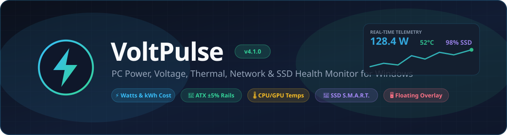
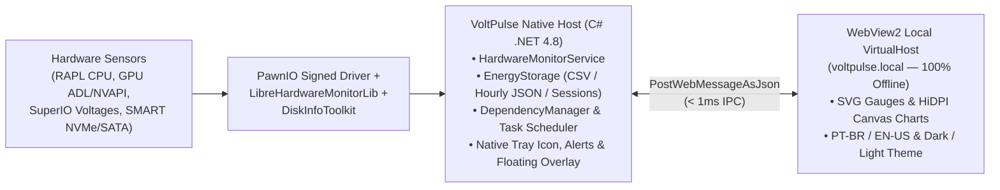

<p align="center">
  
</p>

<p align="center">
  <strong>🇺🇸 English</strong> &nbsp;|&nbsp; <a href="README.pt-BR.md"><strong>🇧🇷 Português (Brasil)</strong></a>
</p>

<p align="center">
  
  
  
  
  
  
</p>

---

**VoltPulse** is a lightweight, native, open-source Windows desktop application that monitors **real-time PC power consumption (Watts, kWh, and electricity bill cost)**, **motherboard/CPU/GPU voltages with ATX ±5% validation**, **temperatures**, **SSD/NVMe/HDD S.M.A.R.T. health & lifespan**, **fans**, **clocks**, and **live network traffic** — running discreetly in the system tray with zero Electron bloat.

---

## Table of Contents

- [Key Features](#-key-features)
- [How It Works (Architecture)](#-how-it-works-architecture)
- [Power & Cost Calculation Formula](#-power--cost-calculation-formula)
- [Installation (End Users)](#-installation-end-users)
- [Dependencies & Third-Party Libraries](#-dependencies--third-party-libraries)
- [Building from Source](#-building-from-source)
- [Security & Privacy](#-security--privacy)
- [Troubleshooting & FAQ](#-troubleshooting--faq)
- [Contributing & License](#-contributing--license)

---

## ✨ Key Features

| Category | Capabilities |
| :--- | :--- |
| **⚡ Energy & Cost Tracking** | Real-time estimated wall draw (W), automatic **Daily / Weekly (7d) / Monthly** accumulation in **kWh** and configurable currency (`$`, `R$`, `€`), monthly projection, **Hourly breakdown (00h–23h)**, **14-day interactive bar chart**, **Electricity Cost Simulator**, and 1-click **CSV export**. |
| **🎮 Session / Gaming Meter** | Start a named session before gaming, rendering, or working to track exact duration, energy used (kWh), session cost, average/peak Watts, and peak CPU/GPU temperatures. |
| **🌡️ Thermal Telemetry** | Animated SVG radial gauges for CPU and GPU with dynamic color zones (`Cool`, `Ideal`, `Warm`, `Critical`), live dual-line thermal chart with hover tooltips, and full sensor table (CPU, GPU Core, GPU Hot Spot, Motherboard/VRM, Storage). |
| **🔌 Voltage Monitor + ATX ±5%** | Highlight cards for `+12V`, `+5V`, `VCore`, and `GPU Core`, automatic **ATX ±5% tolerance validation** on PSU/motherboard rails (`+12V`, `+5V`, `+3.3V`), search/category filters, and min/max oscillation (`Δ`). |
| **💾 SSD / NVMe / HDD Health** | CrystalDiskInfo-style **Remaining Life (%)** circular gauge, health status (`Good`, `Caution`, `Critical`), temperature, **TBW (Total Bytes Written)**, Total Read, Power-On Hours & Count, TRIM status, used space bar, and expandable full **S.M.A.R.T. attributes** table. |
| **🖥️ Floating Overlay & Alerts** | Compact, semi-transparent, draggable **Always-on-Top Mini Widget** (`W • CPU °C • GPU °C • RAM %`) plus native Windows toast notifications for **critical temperatures**, **out-of-spec ATX voltages**, and **monthly cost budgets**. |
| **🌐 Global Currency, 8 Languages & Boot** | **Auto-detects your country's currency & average kWh rate** from Windows (`BRL`, `USD`, `EUR`, `GBP`, `CAD`, `AUD`, `CHF`, `MXN`, `ARS`, `JPY`, `CNY`, `INR`, `KRW`, `PLN` + custom), **8 languages** (`PT-BR`, `EN-US`, `ES`, `FR`, `DE`, `IT`, `JA`, `ZH`), live Download/Upload network speed, Dark/Light theme, **UAC-free startup**, and 1-click auto-setup (PawnIO + WebView2). |

---

## 🏗️ How It Works (Architecture)

VoltPulse combines a tiny (~60 KB) native **C# (.NET Framework 4.8)** backend with Windows' built-in **Microsoft Edge WebView2** engine (no bundled Chromium — the entire portable release ZIP is under 5 MB including the offline driver installer).



### Local Data Storage
All data stays 100% on your machine inside `%LocalAppData%\PcPowerMonitor\`:
- `settings.json` — Tariff, PSU efficiency, base system watts, alert thresholds, theme, language, and overlay position.
- `energy_history.csv` — Daily energy totals (`Date,EnergyWh,ActiveSeconds,PeakWatts,SampleCount`), readable directly in Excel/Calc.
- `hourly_today.json` — 24-hour energy breakdown for the current day.
- `crash.log` — Diagnostic error log (created only if an unexpected error occurs).

---

## 📐 Power & Cost Calculation Formula

Software sensors directly read CPU package power (Intel RAPL / AMD SMU) and GPU board/package power, but motherboards, RAM, SSDs, fans, and PSU conversion losses are not individually metered. VoltPulse estimates realistic wall draw using:

$$\text{Wall Power (W)} = \frac{\text{CPU (W)} + \text{GPU (W)} + \text{Other Sensors (W)} + \text{Base System (W)}}{\text{PSU Efficiency (\%)} / 100}$$

- **PSU Efficiency (%)**: Typical presets are `80%` (80+ White), `85%` (80+ Bronze), `90%` (80+ Gold), and `92%` (80+ Platinum).
- **Base System Extra (W)**: Default `30 W` covers motherboard, RAM, SSDs, and case fans (or set `60 W` / `90 W` if you also want to include 1–2 monitors).
- **Anti-Suspension Protection**: Each sample integrates $\Delta \text{Wh} = W \times \frac{\Delta t}{3600}$ with a 15-second cap per tick so sleep/hibernation intervals are never miscounted as active power draw.

---

## 🚀 Installation (End Users)

### Option A — Windows Installer (Recommended)
1. Download **`VoltPulse-Setup-v3.2.0.exe`** from the [Releases](https://github.com/luanwsantos97/VoltPulse/releases/latest) page.
2. Run the installer — it installs cleanly to `C:\Program Files (x86)\VoltPulse`, registers in **Windows Apps & Features** (`HKLM\SOFTWARE\VoltPulse` + `App Paths`), creates **Start Menu & Desktop shortcuts**, automatically installs **PawnIO** and **WebView2** if missing, and optionally enables UAC-free startup!
3. Open **Settings** to fine-tune your local electricity rate (currency & average rate are auto-detected from Windows).

### Option B — Portable ZIP
1. Download **`VoltPulse-v3.2.0-win-x64.zip`** from [Releases](https://github.com/luanwsantos97/VoltPulse/releases/latest), extract anywhere, and run **`VoltPulse.exe`**.

> **Tip:** You can also launch VoltPulse anytime via `Win + R` → type `voltpulse` → Enter!

---

## 📦 Dependencies & Third-Party Libraries

Every dependency is fetched from official NuGet / GitHub releases during build via [`scripts/fetch-deps.ps1`](scripts/fetch-deps.ps1) (no compiled binaries are committed to Git):

| Dependency | Version | License | Purpose |
| :--- | :--- | :--- | :--- |
| **[LibreHardwareMonitorLib](https://github.com/LibreHardwareMonitor/LibreHardwareMonitor)** | `0.9.6` | MPL-2.0 | Reads CPU power (RAPL/SMU), GPU power/temp/clocks, motherboard SuperIO voltages, fans, RAM, and network throughput. |
| **[PawnIO](https://pawnio.eu/)** (`namazso/PawnIO.Setup`) | `2.2.0+` | Open-Source / Signed | Modern Microsoft-signed kernel driver required on Windows 10/11 (replaces deprecated WinRing0 blocked by Defender) for CPU, motherboard, and storage access. Bundled in release `deps/` for offline 1-click setup. |
| **[Microsoft.Web.WebView2](https://developer.microsoft.com/en-us/microsoft-edge/webview2/)** | `1.0.4370.26` | BSD / MS | Embeds Windows' native Chromium-based WebView2 engine for the modern HTML5/Canvas/SVG dashboard. |
| **[DiskInfoToolkit](https://github.com/BlackINT3/DiskInfoToolkit)** | `1.1.2` | MIT | Reads NVMe/SATA S.M.A.R.T. attributes, remaining SSD lifespan (%), TBW, power-on hours, and disk status. |
| **[BlackSharp.Core](https://www.nuget.org/packages/BlackSharp.Core)** | `1.0.7` | MIT | Core utility library required by DiskInfoToolkit and RAMSPDToolkit. |
| **[HidSharp](https://www.zer7.com/software/hidsharp)** | `2.6.4` | Apache-2.0 | USB HID communication for supported PSUs and fan/AIO controllers. |
| **[RAMSPDToolkit-NDD](https://www.nuget.org/packages/RAMSPDToolkit-NDD)** | `1.4.2` | MPL-2.0 | Memory SPD/temperature reading support used by LibreHardwareMonitorLib. |
| **.NET Framework 4.8 (`csc.exe`)** | Built-in | Microsoft | Pre-installed on Windows 10/11 — compiles VoltPulse without requiring Visual Studio or the .NET SDK. |

---

## 🛠️ Building from Source

No Visual Studio or .NET SDK installation is required on Windows 10/11 — the build script uses Windows' built-in C# compiler (`csc.exe`) and downloads NuGet packages automatically:

```powershell
# 1. Clone the repository
git clone https://github.com/luanwsantos97/VoltPulse.git
cd VoltPulse

# 2. Build executable -> dist/VoltPulse/VoltPulse.exe
powershell -ExecutionPolicy Bypass -File .\build.ps1

# 3. Build + generate GitHub Release ZIP -> releases/VoltPulse-v3.0.0-win-x64.zip
powershell -ExecutionPolicy Bypass -File .\build.ps1 -ReleaseZip -Version "3.0.0"
```

### Automated Releases (GitHub Actions)
This repository includes [`.github/workflows/release.yml`](.github/workflows/release.yml). Pushing any `v*` tag automatically compiles the project on `windows-latest` and publishes the release ZIP:

```bash
git tag v3.0.0
git push origin v3.0.0
```

### UI Preview Mode (Browser)
You can open `ui/index.html` directly in any modern browser to preview or develop the dashboard UI — `ui/app.js` automatically detects browser mode and feeds realistic simulated telemetry data.

---

## 🔒 Security & Privacy

- **100% Offline & Local**: VoltPulse has **zero analytics, zero telemetry upload, and zero background network servers**. The UI runs via WebView2's in-memory virtual host (`voltpulse.local`), not an open TCP port.
- **Network Access**: Only used when you explicitly click **"Install Automatically"** in the first-run dependency wizard (downloading official signed installers from `github.com/namazso/PawnIO.Setup` or `go.microsoft.com`).
- **Administrator Privileges**: Required solely to read hardware MSRs, SuperIO sensors, and physical disk S.M.A.R.T. registers. See [SECURITY.md](SECURITY.md) for details.

---

## ❓ Troubleshooting & FAQ

- **Why are CPU power/temp or motherboard voltages showing `--` or `0`?**
  Make sure you accepted the Administrator prompt and installed the signed **PawnIO** driver (click **Settings → Install / Verify Dependencies** inside VoltPulse).
- **Why does VoltPulse estimate slightly differently from a wall plug wattmeter?**
  Software cannot measure exact PSU conversion loss across every load curve or external peripherals (monitors, speakers, routers). Calibrate **PSU Efficiency (%)** and **Base System Extra (W)** in Settings to match your setup within ~5%.
- **Does closing the window stop counting energy?**
  No — by default, clicking `X` minimizes VoltPulse to the system tray so daily/weekly/monthly totals stay accurate. Right-click the tray icon → **Exit completely** to close it.

---

## 🤝 Contributing & License

Contributions, bug reports, and feature requests are welcome! See [CONTRIBUTING.md](CONTRIBUTING.md) and [CHANGELOG.md](CHANGELOG.md).

Distributed under the **MIT License** — see [LICENSE](LICENSE).
