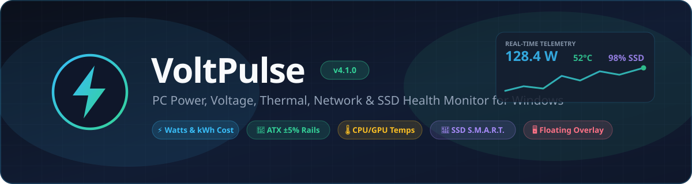
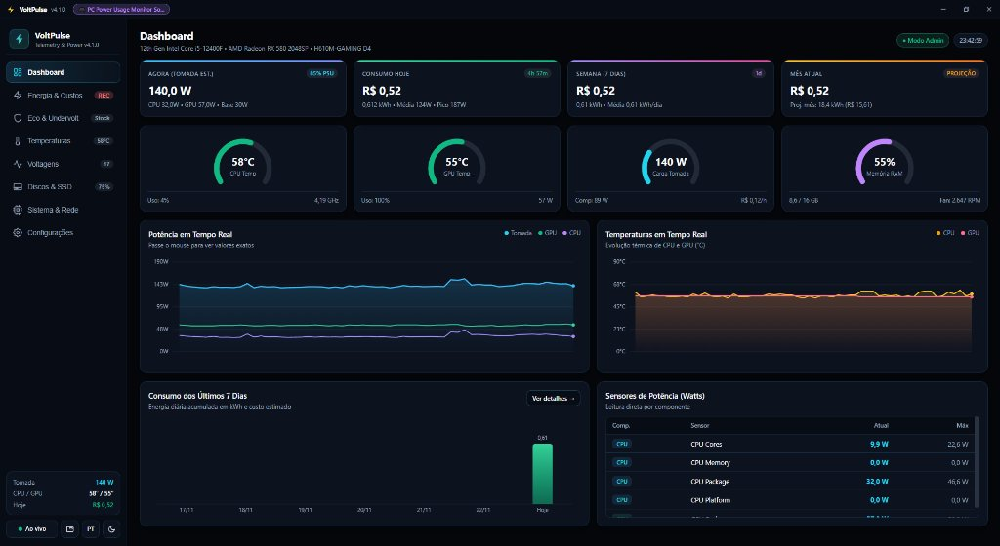
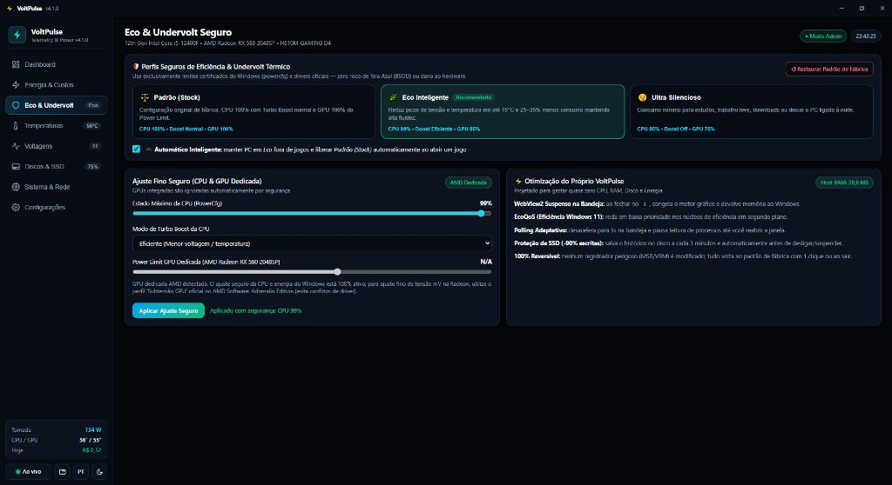
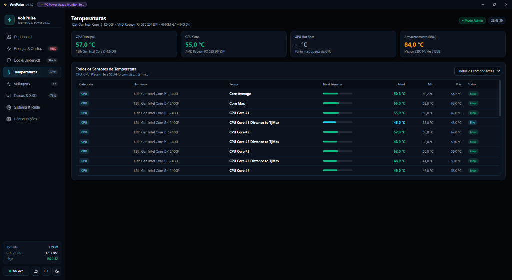
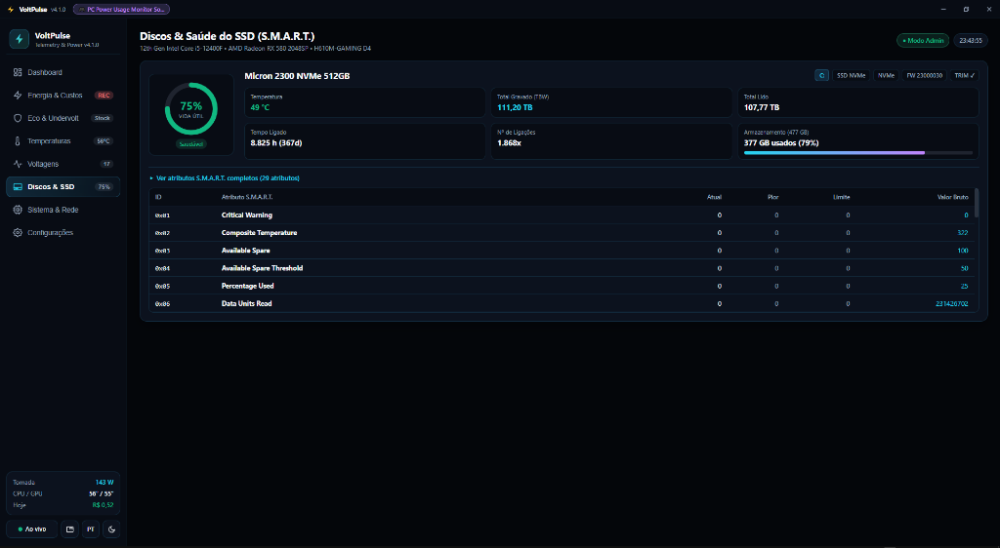
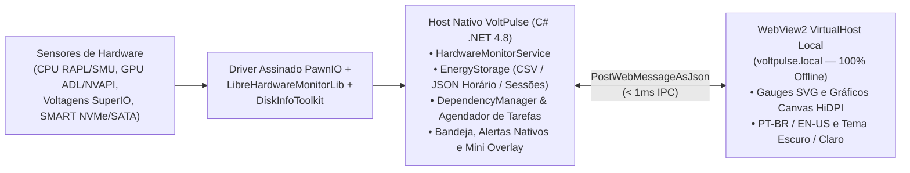

<p align="center">
  
</p>

<p align="center">
  <a href="README.md"><strong>🇺🇸 English</strong></a> &nbsp;|&nbsp; <strong>🇧🇷 Português (Brasil)</strong>
</p>

<p align="center">
  
  
  
  
  
  
</p>

---

O **VoltPulse** é um aplicativo desktop leve, nativo e open-source para Windows que monitora em tempo real o **gasto de energia do seu PC (Watts, kWh e custo na conta de luz)**, **voltagens com validação ATX (±5%)**, **temperaturas**, **saúde e vida útil de SSD/NVMe/HD (S.M.A.R.T.)**, **ventoinhas**, **clocks** e **tráfego de rede** — rodando discretamente na bandeja do sistema sem o peso de apps Electron.

---

## Índice

- [Recursos Principais](#-recursos-principais)
- [Como Funciona (Arquitetura)](#-como-funciona-arquitetura)
- [Cálculo de Energia e Como Achar Sua Tarifa (R$/kWh)](#-cálculo-de-energia-e-como-achar-sua-tarifa-rkwh)
- [Instalação (Usuários Finais)](#-instalação-usuários-finais)
- [Dependências e Bibliotecas Utilizadas](#-dependências-e-bibliotecas-utilizadas)
- [Como Compilar do Código-Fonte](#-como-compilar-do-código-fonte)
- [Segurança e Privacidade](#-segurança-e-privacidade)
- [Solução de Problemas (FAQ)](#-solução-de-problemas-faq)
- [Contribuindo e Licença](#-contribuindo-e-licença)

---

## 📸 Capturas de Tela

| Dashboard em Tempo Real | Eco & Undervolt Seguro |
| :---: | :---: |
|  |  |
| **Monitor de Temperaturas** | **Saúde & Vida Útil de SSD (S.M.A.R.T.)** |
|  |  |

---

## ✨ Recursos Principais

| Categoria | Funcionalidades |
| :--- | :--- |
| **⚡ Energia & Conta de Luz** | Potência estimada na tomada (W) ao vivo, acumulado automático de **Hoje**, **Semana (7 dias)** e **Mês Atual** em **kWh** e moeda configurável (`R$`, `$`, `€`), projeção mensal, **Consumo por Hora (00h–23h)**, **gráfico interativo de 14 dias**, **Simulador de Conta de Luz** e exportação **CSV** em 1 clique. |
| **🎮 Modo Jogo Automático & Quieto** | Detecta automaticamente jogos iniciados (Steam, Epic, Riot, Xbox, EA, Ubisoft, Battle.net, GOG ou tela cheia/GPU), inicia e finaliza o medidor de sessão sozinho, silencia avisos não-críticos, abre o Overlay opcionalmente e roda quieto em segundo plano. |
| **🎨 Janela Sem Bordas & 6 Temas** | Barra de título 100% integrada ao tema (Minimizar/Maximizar/Fechar estilizados, sem barra padrão do Windows), **6 temas visuais** (`Dark Slate`, `OLED Midnight`, `Cyber Neon`, `Forest Emerald`, `Sunset Carbon`, `Clean Light`) e **Ícone Dinâmico na Bandeja** (`Logo` / `CPU °C` / `Watts`). |
| **🛡️ Eco / Undervolt Seguro & Ultra-Leve** | Perfis 1-clique certificados (**Padrão / Eco / Ultra Silencioso** + **Eco automático fora de jogos**) via `powercfg` oficial e `nvidia-smi` dentro da faixa `[Mín, Padrão]` de fábrica (GPUs integradas são bloqueadas por segurança — zero risco de BSOD). Na bandeja, suspende o WebView2, ativa **EcoQoS**, usa polling adaptativo de 5s e reduz em **90%** as escritas no SSD! |
| **🌡️ Telemetria Térmica** | Medidores circulares SVG animados para CPU e GPU com faixas dinâmicas (`Frio`, `Ideal`, `Quente`, `Crítico`), gráfico térmico ao vivo com tooltip interativo e tabela completa (CPU, GPU Core, GPU Hot Spot, Placa-mãe/VRM e SSD/HD). |
| **🔌 Voltagens & Validação ATX (±5%)** | Cards de destaque para `+12V`, `+5V`, `VCore` e `GPU Core`, validação automática da tolerância **ATX ±5%** nas trilhas da fonte/placa-mãe (`+12V`, `+5V`, `+3.3V`), busca, filtros por componente e cálculo de oscilação (`Δ = Máx − Mín`). |
| **💾 Saúde & Vida Útil de SSD / HD** | Visual estilo **CrystalDiskInfo** com gauge circular de **Vida Útil (%)**, status (`Saudável`, `Atenção`, `Crítico`), temperatura, **TBW (Total Gravado)**, Total Lido, Horas Ligado, Nº de Ligações, TRIM, barra de espaço ocupado e tabela completa de atributos **S.M.A.R.T.**. |
| **🖥️ Mini Widget Flutuante & Alertas** | **Overlay compacto** sempre no topo, arrastável e semi-transparente (`W • CPU °C • GPU °C • RAM %`) + notificações nativas do Windows para **temperatura crítica**, **voltagem ATX fora de faixa** e **meta de gasto mensal**. |
| **🌐 Moeda Global, 8 Idiomas & Rede** | **Detecta automaticamente a moeda e tarifa padrão do seu país** pelo Windows (`R$`, `$`, `€`, `£`, `C$`, `A$`, `CHF`, `MX$`, `¥`, `₹`, `₩`, `zł` + custom), **8 idiomas** (`PT-BR`, `EN`, `ES`, `FR`, `DE`, `IT`, `JA`, `ZH`), tráfego de rede ao vivo, Tema Escuro/Claro, **boot sem UAC** e instalador automático (PawnIO + WebView2). |

---

## 🏗️ Como Funciona (Arquitetura)

O VoltPulse combina um backend nativo super leve (~60 KB) em **C# (.NET Framework 4.8)** com o motor **Microsoft Edge WebView2** já embutido no Windows (sem empacotar um navegador Chromium inteiro — o `.zip` portátil completo tem menos de 5 MB, já incluindo o instalador offline do driver).



### Armazenamento Local de Dados
Todos os dados ficam salvos localmente em `%LocalAppData%\PcPowerMonitor\`:
- `settings.json` — Tarifa, eficiência da fonte, consumo base, alertas, tema, idioma e posição do Overlay.
- `energy_history.csv` — Histórico diário (`Date,EnergyWh,ActiveSeconds,PeakWatts,SampleCount`), pronto para abrir no Excel/Google Sheets.
- `hourly_today.json` — Consumo distribuído nas 24 horas do dia atual.
- `crash.log` — Log de diagnóstico (criado apenas se ocorrer alguma falha inesperada).

---

## 📐 Cálculo de Energia e Como Achar Sua Tarifa (R$/kWh)

Sensores de software medem diretamente a potência da CPU (Intel RAPL / AMD SMU) e da GPU, mas placa-mãe, memória RAM, SSDs, ventoinhas e a perda de conversão da fonte não têm sensor individual. Por isso, o VoltPulse estima a potência puxada na tomada com a fórmula:

$$\text{Tomada (W)} = \frac{\text{CPU (W)} + \text{GPU (W)} + \text{Outros sensores (W)} + \text{Base extra (W)}}{\text{Eficiência da Fonte (\%)} / 100}$$

- **Eficiência da Fonte (%)**: `80%` (80 Plus White), `85%` (Bronze), `90%` (Gold), `92%` (Platinum).
- **Consumo Base Extra (W)**: padrão `30 W` para o gabinete (placa-mãe, RAM, SSD, fans), ou `60 W` / `90 W` se quiser incluir 1 ou 2 monitores no cálculo.
- **Proteção contra Suspensão**: o integrador limita cada amostra a no máximo 15s, garantindo que o tempo em que o PC esteve suspenso ou hibernando nunca seja contabilizado.

### Como encontrar sua tarifa real (R$/kWh) na conta de luz
O jeito mais preciso (que já inclui ICMS, PIS/COFINS e bandeira tarifária) é pegar na sua fatura:
1. O **Valor Total da conta** (subtraindo apenas a taxa fixa de *Iluminação Pública / COSIP*, se quiser máxima exatidão).
2. O **Consumo total do mês em kWh**.
3. Dividir um pelo outro: `Valor da energia (R$) ÷ Consumo (kWh)`.

> **Exemplo:** Conta de R\$ 215,00 (com R\$ 15,00 de iluminação pública → R\$ 200,00 de energia) e consumo de `220 kWh` → `200 ÷ 220 = R$ 0,91 / kWh`.

---

## 🚀 Instalação (Usuários Finais)

### Opção A — Instalador do Windows (Recomendado)
1. Baixe **`VoltPulse-Setup-v3.2.0.exe`** na aba [Releases](https://github.com/luanwsantos97/VoltPulse/releases/latest).
2. Execute o instalador — ele instala em `C:\Program Files (x86)\VoltPulse` (personalizável), registra no **Registro do Windows** (`HKLM\SOFTWARE\VoltPulse`, `App Paths` e **Aplicativos Instalados** com desinstalador oficial), cria atalhos no **Menu Iniciar e Área de Trabalho**, instala automaticamente o **PawnIO** e o **WebView2** caso faltem, e oferece a opção de **Iniciar com o Windows sem pop-up UAC**.
3. Abra **Configurações** se quiser ajustar sua tarifa exata de energia (a moeda e tarifa média do país já são detectadas automaticamente pelo Windows).

### Opção B — Versão Portátil (ZIP)
1. Baixe **`VoltPulse-v3.2.0-win-x64.zip`** em [Releases](https://github.com/luanwsantos97/VoltPulse/releases/latest), extraia em qualquer pasta e execute **`VoltPulse.exe`**.

> **Dica:** Depois de instalado, você pode abrir o VoltPulse de qualquer lugar pressionando `Win + R` → digite `voltpulse` → Enter!

---

## 📦 Dependências e Bibliotecas Utilizadas

Todas as dependências são baixadas automaticamente das fontes oficiais (NuGet e GitHub) durante o build via [`scripts/fetch-deps.ps1`](scripts/fetch-deps.ps1) (nenhum binário compilado é commitado no Git):

| Dependência | Versão | Licença | Função no Projeto |
| :--- | :--- | :--- | :--- |
| **[LibreHardwareMonitorLib](https://github.com/LibreHardwareMonitor/LibreHardwareMonitor)** | `0.9.6` | MPL-2.0 | Leitura de potência da CPU (RAPL/SMU), GPU, voltagens SuperIO da placa-mãe, ventoinhas, RAM e rede. |
| **[PawnIO](https://pawnio.eu/)** (`namazso/PawnIO.Setup`) | `2.2.0+` | Open-Source / Assinado | Driver moderno assinado pela Microsoft exigido no Windows 10/11 (substitui o antigo WinRing0 bloqueado pelo Defender). Já vai embutido em `deps/` no `.zip` de Release para instalação offline em 1 clique. |
| **[Microsoft.Web.WebView2](https://developer.microsoft.com/en-us/microsoft-edge/webview2/)** | `1.0.4370.26` | BSD / MS | Renderiza a dashboard moderna HTML5/Canvas/SVG usando o motor nativo do Windows. |
| **[DiskInfoToolkit](https://github.com/BlackINT3/DiskInfoToolkit)** | `1.1.2` | MIT | Lê atributos S.M.A.R.T. de SSDs NVMe/SATA e HDs: vida útil (%), TBW, horas ligado, temperatura e status. |
| **[BlackSharp.Core](https://www.nuget.org/packages/BlackSharp.Core)** | `1.0.7` | MIT | Biblioteca base utilizada pelo DiskInfoToolkit e RAMSPDToolkit. |
| **[HidSharp](https://www.zer7.com/software/hidsharp)** | `2.6.4` | Apache-2.0 | Comunicação USB HID para fontes inteligentes e controladoras compatíveis. |
| **[RAMSPDToolkit-NDD](https://www.nuget.org/packages/RAMSPDToolkit-NDD)** | `1.4.2` | MPL-2.0 | Suporte a leitura SPD/temperatura de módulos de memória RAM. |
| **.NET Framework 4.8 (`csc.exe`)** | Nativo | Microsoft | Já vem instalado no Windows 10/11 — permite compilar sem precisar de Visual Studio nem .NET SDK. |

---

## 🛠️ Como Compilar do Código-Fonte

Não precisa instalar Visual Studio nem .NET SDK no Windows 10/11 — o script usa o compilador `csc.exe` nativo do sistema e baixa as bibliotecas automaticamente:

```powershell
# 1. Clonar o repositório
git clone https://github.com/luanwsantos97/VoltPulse.git
cd VoltPulse

# 2. Compilar executável -> dist/VoltPulse/VoltPulse.exe
powershell -ExecutionPolicy Bypass -File .\build.ps1

# 3. Compilar + gerar o .zip pronto para GitHub Releases -> releases/VoltPulse-v3.0.0-win-x64.zip
powershell -ExecutionPolicy Bypass -File .\build.ps1 -ReleaseZip -Version "3.0.0"
```

### Releases Automáticas (GitHub Actions)
O repositório já vem com [`.github/workflows/release.yml`](.github/workflows/release.yml). Sempre que você enviar uma tag `v*`, o próprio GitHub compila tudo em `windows-latest` e publica o `.zip` automaticamente na página de Releases:

```bash
git tag v3.0.0
git push origin v3.0.0
```

### Pré-visualização Rápida da UI no Navegador
Você pode abrir `ui/index.html` diretamente no navegador para editar ou visualizar o design — o `ui/app.js` ativa automaticamente um modo de demonstração com dados simulados realistas fora do WebView2.

---

## 🔒 Segurança e Privacidade

- **100% Local e Offline**: o VoltPulse não coleta telemetria, não envia dados para servidores externos e não abre nenhuma porta HTTP na rede (a interface roda via host virtual em memória `voltpulse.local`).
- **Acesso à Internet**: usado exclusivamente se você clicar em **"Instalar Automaticamente"** no assistente inicial (baixando os instaladores oficiais do GitHub do `PawnIO` ou da Microsoft para o `WebView2`).
- **Privilégios de Administrador**: exigidos apenas para acessar registradores MSR de hardware, sensores SuperIO da placa-mãe e S.M.A.R.T. físico dos discos. Veja [SECURITY.md](SECURITY.md).

---

## ❓ Solução de Problemas (FAQ)

- **Os sensores da CPU ou da placa-mãe aparecem zerados ou `--`?**
  Confirme que o app foi aberto em Modo Administrador e que o driver **PawnIO** está instalado (clique em **Configurações → Instalar / Verificar Dependências**).
- **Por que pode haver pequena diferença em relação a um wattímetro de tomada?**
  Softwares não medem a perda exata da fonte em cada faixa de carga nem periféricos externos (monitor, caixa de som, roteador). Ajustando **Eficiência da Fonte (%)** e **Consumo Base Extra (W)** nas Configurações, a estimativa costuma ficar dentro de ~5% do valor real.
- **Ao clicar no `X`, o programa para de contar o consumo?**
  Não! Por padrão ele minimiza para a bandeja do sistema para continuar somando o consumo do dia. Para encerrar completamente, clique com o botão direito no ícone da bandeja → **Sair completamente**.

---

## 🤝 Contribuindo e Licença

Contribuições, sugestões e relatos de bugs são muito bem-vindos! Veja [CONTRIBUTING.md](CONTRIBUTING.md) e [CHANGELOG.md](CHANGELOG.md).

Distribuído sob a licença **MIT** — veja [LICENSE](LICENSE).
